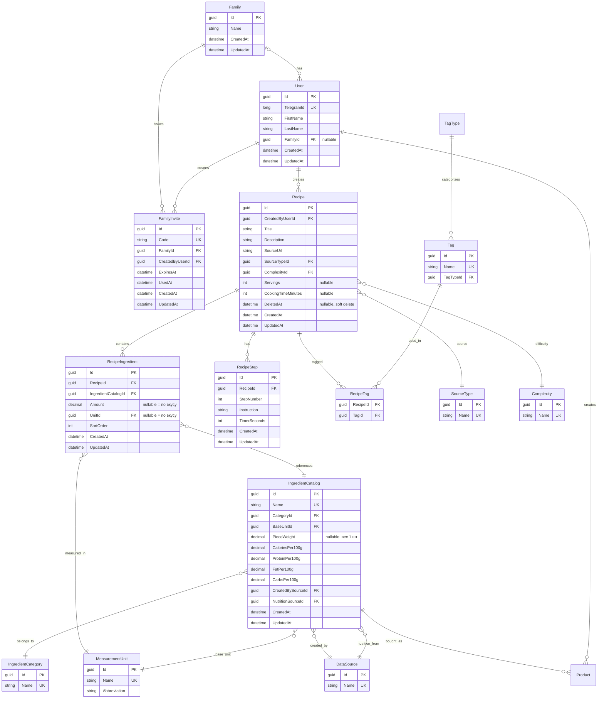

# CLAUDE.md

This file provides guidance to Claude Code (claude.ai/code) when working with code in this repository.

## О проекте

**Cooking** — личный кулинарный помощник. Telegram-бот + PWA. Изначально для автора и девушки, но бот можно расшарить друзьям: каждый пользователь самостоятельный, а семьи (Family) — группы, внутри которых рецепты общие.

Ключевая ценность: закинул ссылку на Reels/текст рецепта → бот сам достаёт рецепт, структурирует его через LLM и считает КБЖУ по каталогу ингредиентов, а стоимость — по продуктам, которые покупает семья.

## Текущее состояние реализации

Готово: EF Core + миграции, КБЖУ и стоимость рецепта (`NutritionCalculator`), справочники с seed'ом, CRUD каталога ингредиентов, тегов, Family/User с приглашениями, Recipe CRUD (доступ по семье, soft delete), Telegram-бот (регистрация, семьи, список/поиск/карточка рецептов), LLM-разбор рецепта из текста (черновик → превью → подтверждение, см. «Разбор рецептов из текста»), Serilog/Seq, юнит-тесты (xUnit + EF InMemory) и CI. Каждая фича — `I<Feature>RepositoryService` в Application + реализация в `Infrastructure/Repositories`, MediatR-хендлеры тонкие, ошибки — `FluentResults` + `AppError(ErrorCode)` → HTTP-статус в `BaseController`.

Авторизация — отдельный сервис `Cooking.Auth` (OAuth 2.0 / OpenID Connect, см. «Авторизация»): вход через бота и через Telegram Login Widget, JWT в Api, Swagger; Auth задеплоен на `auth.cocking.fyi`. PWA — начата (`web/`, см. «PWA (web/)»): вход через Auth, список рецептов (загружается целиком, поиск и группы на клиенте) и страница рецепта с пересчётом порций, 4 темы.

Все проекты нацелены на **net8.0** (nullable + implicit usings включены).

## Структура решения

```
Cooking/
├── docker-compose.yml          # PostgreSQL + RabbitMQ
├── Cooking.sln
└── src/
    ├── Cooking.Domain/          # Entities, enums, interfaces (Class Library)
    ├── Cooking.Application/     # MediatR handlers, DTOs, use cases (Class Library)
    ├── Cooking.Infrastructure/  # EF Core, внешние API (Class Library)
    ├── Cooking.Bot/             # Telegram-бот: обработчик апдейтов, клавиатуры, polling/webhook (Class Library)
    ├── Cooking.Api/             # Web API; хостит бота и фоновый разбор рецептов в своём процессе (ASP.NET Core Web API)
    └── Cooking.Auth/            # Сервер авторизации (OpenIddict): вход через Telegram, выдаёт JWT для Api — отдельный процесс/контейнер
```

Зависимости между проектами (Clean Architecture, ссылки идут только "внутрь"):

```
Domain ← Application ← Infrastructure ← Api, Auth
                     ← Bot ← Api (хостит бота)
```

Бот — такой же слой представления, как контроллеры Api, поэтому живёт в отдельной библиотеке, а не в Api/Application/Infrastructure. Фоновой обработке, которой нужно написать пользователю (например, «рецепт из Reels готов»), бот доступен через интерфейс в Application (`IRecipeDraftNotifier`), а не прямой ссылкой.

`AddInfrastructure` — база и репозитории (нужны Api и Auth), `AddRecipeParsing` — LLM, Reels и фоновая очередь (только Api).

## Правила разработки

Обязательны для всего нового кода. Если правило мешает — сначала обсуждаем и меняем его здесь, потом код.

### Бэкенд: путь запроса

```
Controller (Api) / BotUpdateHandler (Bot)            — только перевод HTTP/Telegram ↔ команда
  └─► MediatR: LoggingBehavior → ValidationBehavior   — журнал действия; FluentValidation до хендлера
        └─► Handler (Application)                     — сценарий: вызывает интерфейсы, сам в базу не ходит
              └─► I<Feature>RepositoryService (Application, интерфейс)
                    └─► <Feature>RepositoryService (Infrastructure) — EF Core через IDataContext, проверки доступа
```

- **Контроллеры и бот тонкие**: прочитать запрос → собрать команду (`UserId = CurrentUserId` из токена, никогда из тела запроса) → `Mediator.Send` → `HandleResult`. Логики, EF и `try/catch` в них нет.
- **Хендлеры** не знают про EF и HTTP. CRUD-хендлер — одна строка (делегирует репозиторию); сценарий из нескольких шагов (как `ParseRecipeDraftCommandHandler`) — оркестрирует интерфейсы. `IDataContext` в Application не используется (исключение — health check).
- **Репозиторий-сервис** (`I<Feature>RepositoryService` в Application, реализация в `Infrastructure/Repositories`) — вся работа с базой фичи и проверки, которым нужна база: существование связанных записей, права доступа (рецепт видят автор и семья), конфликты.
- **Внешние сервисы** (LLM, Whisper, yt-dlp, позже FatSecret) — интерфейс в Application (`IRecipeTextParser`, `ISpeechToText`…), реализация в Infrastructure. Без ключа — не падаем при старте, а отвечаем `ErrorCode.Unavailable`.
- **Результат клиенту из фоновой работы** — через интерфейс в Application (`IRecipeDraftNotifier`), а не прямым вызовом бота: PWA и бот — равноправные клиенты одних и тех же команд.

### Файлы и имена (Application)

- Папка на фичу: `Application/<Фича>/` → `Commands/`, `Queries/`, `I<Фича>RepositoryService.cs`, DTO, общие `*Fields` + `*FieldsValidator` (поля для create/update).
- На каждую команду три файла: `XxxCommand.cs` (record, `IRequest<Result<T>>`), `XxxCommandHandler.cs`, `XxxCommandValidator.cs`; запросы — так же с `Query`. Один тип — один файл.
- Имя запроса на чтение обязательно оканчивается на `Query` (LoggingBehavior пишет их на Debug), остальное — `Command`. Действие пользователя — свойство `UserId` (по нему LoggingBehavior пишет, кто действовал).
- Ответы — `*Dto` (records); тела HTTP-запросов — `Api/Contracts/*Request` с методом `ToFields()`/`ToCommand()`; списки, не пришедшие в JSON, считаем пустыми.
- Справочники — по константам `ReferenceIds`, а не по имени.

### Ошибки

- Ожидаемые неудачи — не исключения, а `Result.Fail(new AppError(message, ErrorCode))` (FluentResults). Код → HTTP-статус переводит `BaseController.HandleFailure`: `Validation` 400, `Forbidden` 403, `NotFound` 404, `LogicConflict` 409, `ExternalService` 502, `Unavailable` 503.
- Чужой ресурс — `NotFound`, а не `Forbidden`: не раскрываем, что он существует.
- Исключения — только для неожиданного; их ловит `GlobalExceptionHandler` (500; нарушение unique/FK в Postgres → 409).
- Текст `AppError` и логов — по-английски; текст, который видит пользователь (бот, страница входа, заголовки ProblemDetails), — по-русски.

### Логирование (Serilog → Seq)

- **Где пишем:**
  - `LoggingBehavior` — одна строка на каждую команду/запрос (кто, что, сколько мс, итог). Поэтому в хендлерах, репозиториях и контроллерах логов **нет**.
  - Интеграции с внешним миром (LLM, Whisper, yt-dlp, Telegram API): Information — краткий итог успеха (размер, время), Warning — отказ сервиса, Error — исключение.
  - Фоновые службы (`RecipeParsingBackgroundService`, polling бота): Warning — задача не выполнена, Error — исключение (служба при этом продолжает работать).
  - Auth — явные логи входа и выдачи токенов (там нет MediatR, LoggingBehavior не работает).
  - `GlobalExceptionHandler` — Error на каждое необработанное исключение.
- **Уровни:** Debug — частое и шумное (опрос входа, запросы на чтение); Information — действия пользователей и итоги интеграций; Warning — ожидаемые сбои; Error — исключения.
- **Никогда не пишем:** токены и ключи (бота, API, JWT, refresh), PollToken, код входа, данные Telegram Login Widget, тексты рецептов и правок, тела запросов. Можно: Id пользователя/черновика, имя, длины, статусы, время.
- Только шаблоны с плейсхолдерами (`"Draft {DraftId} parsed"`), без интерполяции `$"..."` — иначе Seq не сможет фильтровать по полям.

### Хосты (Api, Auth)

- Только контроллеры, без minimal API (исключение — webhook бота в `Cooking.Bot`). Логика хоста — в `Services/`, настройки — `Options/` (класс на файл), запросы/ответы — `Contracts/`, шаги запуска — `Seeding/` (явный вызов, не скрытый hosted service).
- `Program.cs` читается сверху вниз: регистрации — `Extensions/ServiceCollectionExtensions.cs` (`AddXxx`), конвейер и шаги старта — `Extensions/WebApplicationExtensions.cs`.

### Конфигурация и секреты

- Настройки — секциями в `appsettings.json` + класс в `Options/`. Секреты — только `dotnet user-secrets` локально и переменные окружения (из GitHub Secrets) в проде; в git — никогда.

### База

- Code First: конфигурация сущности — `Infrastructure/Persistence/Configurations/<область>/<Сущность>Configuration.cs`; все сущности — от `BaseEntity` (кроме справочников).
- Миграция: `dotnet ef migrations add <Имя> --project src/Cooking.Infrastructure --startup-project src/Cooking.Api`; Id существующих seed-записей не меняем.

### Тесты

- xUnit. `Application.Tests` — репозитории-сервисы на EF InMemory и валидаторы; чистые функции (маппер, калькулятор КБЖУ, форматирование бота, подпись виджета) — обязательно с тестами.
- Имя теста — `Сценарий_Результат` (`DuplicateTags_FailValidation`, `Verify_OutdatedAuthDate_Fails`).

### Код

- Комментарии и XML-doc — по-русски, объясняют «почему», а не «что». Публичные интерфейсы и неочевидные решения — с `<summary>`.
- Новый код повторяет стиль соседнего: primary constructors, records для команд/DTO, `CancellationToken` — последним параметром во всех async-методах.

### Фронтенд (web/)

- Архитектура — Feature-Sliced Design, правила — в разделе «PWA (web/)»; проверка — `npm run build`, `npm run lint`, `npm run lint:fsd`, `npm test` (их же запускает CI, job `web` в `ci.yml`).
- Чистые функции (`lib/`) — с тестами рядом: `имя.test.ts`, Vitest (`describe`/`it` из `vitest`, названия — по-русски: сценарий → результат).
- Только функциональные компоненты; именованные экспорты (`export function RecipeCard`); props — интерфейс `<Компонент>Props`; без `any`.
- Данные, которые вычисляются из state, не храним вторым `useState`.

### Git и процесс

- Ветка фичи — от `main` (`feature/<имя>`) → merge в `dev` → проверка → merge в `main` (push в `main` = деплой). Ветки после мержа не удаляем.
- Сообщения коммитов — по-английски, без строк Co-Authored-By. Push — только с явного согласия.
- Проверка изменений — `dotnet build` / `dotnet test` (и проверки `web/`); приложение запускает и руками проверяет автор.
- Перед мержем в `main` (= деплой) — ревью изменений ветки: `/code-review` (high) по diff с `main`; если затронуты вход, токены, CORS, секреты — ещё `/security-review`. Подтверждённые находки исправляются отдельным коммитом до мержа; спорные — обсуждаем. Ревью запускает автор (не Claude в той же сессии, где писался код).

## Стек

- .NET 8, C#
- PostgreSQL (EF Core, Code First, миграции)
- Фоновая обработка — очередь в памяти процесса (`Channel` + `BackgroundService`) за интерфейсом; RabbitMQ + MassTransit — только если понадобится надёжность/отдельный процесс
- MediatR (CQRS: commands/queries)
- Telegram.Bot SDK
- Whisper API (OpenAI) — Speech-to-Text
- Claude API / OpenAI API — структурирование рецептов через LLM
- SignalR — реалтайм (будущее: список покупок)
- PWA — React + TypeScript + Vite (`web/`, см. «PWA»)

## Команды

- Сборка всего решения: `dotnet build Cooking.sln`
- Запуск API: `dotnet run --project src/Cooking.Api`
- Запуск Auth: `dotnet run --project src/Cooking.Auth` (https://localhost:7271; для входа и Swagger нужны оба — Api и Auth)
- Поднять инфраструктуру (Postgres на 5432, RabbitMQ на 5672 / management UI на 15672): `docker compose up -d`
- Тесты: `dotnet test` (для одного теста: `--filter FullyQualifiedName~<Name>`). `tests/Cooking.Application.Tests` — репозитории на EF InMemory; `tests/Cooking.Bot.Tests` — только чистые функции бота (разбор команд, форматирование карточки); `tests/Cooking.Auth.Tests` — проверка подписи Telegram Login Widget

## MVP — скоуп первой версии

### Платформы
- Telegram-бот — создание + поиск (делается первым)
- PWA — отображение рецептов (делается вторым)

### Создание рецептов
- Вручную (текст)
- Из Instagram Reels (скачивание аудио → Whisper → LLM → структурированный рецепт)

### Карточка рецепта
- Название, описание
- Ингредиенты (ссылка на каталог IngredientCatalog по ID)
- Пошаговые инструкции с таймерами
- Ссылка на источник (URL видео или сайта)
- КБЖУ (считается из каталога ингредиентов)
- Теги (тип приёма, кухня, сложность, время готовки)
- Стоимость (считается по продуктам семьи того, кто смотрит, — см. «Продукты»)
- Масштабирование порций

### Поиск
- По названию (полнотекстовый)
- Семантический (через LLM)

### Многопользовательность
- Много пользователей и много семей. `/start` регистрирует пользователя **без семьи**; дальше он может создать семью или вступить по приглашению
- Приглашение — одноразовый код с ограниченным сроком (FamilyInvite), передаётся deep link'ом `t.me/<bot>?start=<code>`
- Пользователь состоит максимум в одной семье. Последний вышедший участник удаляет семью
- Авторизация через Telegram Login Widget
- Рецепт принадлежит автору (CreatedByUserId), а не семье. В семье видны рецепты всех её участников; при вступлении/выходе ничего не переносится — рецепты уходят вместе с автором
- Права на рецепт: **смотреть и редактировать** — автор и участники его семьи; **удалять** — только автор. Постороннему API отвечает 404 (не 403), чтобы не раскрывать чужие рецепты
- Удаление рецепта — soft delete (`DeletedAt`), удалённые скрыты глобальным query filter'ом EF
- Общее в семье: рецепты участников, списки покупок (принадлежат семье)
- Личное: избранное

### Справочник ингредиентов
- Название, категория, КБЖУ на 100г, единица измерения — общий справочник для всех; цены в каталоге нет (она у продуктов)
- Автозаполнение через LLM при парсинге рецепта
- Два отдельных поля источника: кто создал запись (CreatedBySourceId) и откуда КБЖУ (NutritionSourceId)

### Отложено (не в MVP)
- Список покупок с реалтайм-синхронизацией (SignalR)
- Лайк/дизлайк от каждого пользователя
- YouTube, сайты как источники
- Поиск по фото продуктов, поиск по ингредиентам
- История готовок, рекомендации
- Импорт/экспорт в JSON
- Видимость рецепта (Private / Family / Public, справочник RecipeVisibility): владение (кто редактирует) ≠ видимость (кто видит)
- Общий каталог публичных рецептов (база знаний для всех пользователей, с пагинацией), шаринг рецепта ссылкой, «скопировать себе»
- Сканирование чека → продукты семьи с ценами (KZT), купленный последним становится выбранным (см. идею в конце файла)
- Текст на экране в Reels (рецепт только в титрах): кадры из видео → Claude vision
- Inline-режим: `@бот запрос` в любом чате (нужен `IsPersonal = true`)
- Фото рецептов. В DTO — только ссылка (`photoUrl`), файлы через JSON не ходят; картинки кэширует браузер (HTTP-кэш, позже Service Worker), не `localStorage`. Хранилище — за интерфейсом в Application (`IPhotoStorage`): сначала диск VPS на volume, отдаёт Caddy (`/media/…`), при необходимости — S3-совместимое (Vultr Object Storage) без изменения команд. Имена файлов — `{guid}.webp` (неугадываемые: `` не шлёт Bearer, поэтому файлы публичные, а ссылку выдаёт только Api с проверкой прав) + `Cache-Control: immutable`, новое фото = новое имя. При загрузке — две версии: миниатюра ~400 px для списка/полок и крупная для страницы рецепта (ImageSharp/SkiaSharp). Обложку Reels (yt-dlp) скачиваем к себе — ссылки CDN Instagram протухают. В базе сначала `Recipe.PhotoPath` (string?), таблица `RecipePhoto` — если понадобится несколько фото или фото шагов
- Пользовательские теги («любимое», «для гостей»): у тега владелец (`CreatedByUserId`), видны автору и его семье, как рецепты; системные теги (MealType, кухни) правит только админ. Решить, видит ли их LLM при разборе
- Возможная фича (в реальности пока не встречалась): ссылка на сайт внутри присланного текста → сохранять как источник рецепта (SourceType Website)

## Схема базы данных (Code First, EF Core + PostgreSQL)

Все основные entities наследуют `BaseEntity` (Id: Guid, CreatedAt: DateTime, UpdatedAt: DateTime).

### ERD (mermaid)



### Основные таблицы

#### Family
- Id (Guid, PK)
- Name (string)
- CreatedAt, UpdatedAt

#### User
- Id (Guid, PK)
- TelegramId (long, unique)
- FirstName (string)
- LastName (string?)
- FamilyId (Guid?, FK → Family) — null, пока пользователь не состоит в семье
- Theme (string?, ≤ 32) — тема PWA (id темы или `auto`); null — ещё не выбирал
- CreatedAt, UpdatedAt

#### FamilyInvite
- Id (Guid, PK)
- Code (string, unique, ≤ 64 символов `[A-Za-z0-9_-]` — ограничение start-параметра Telegram)
- FamilyId (Guid, FK → Family, cascade delete)
- CreatedByUserId (Guid, FK → User)
- ExpiresAt (DateTime) — срок действия (7 дней)
- UsedAt (DateTime?) — null, пока приглашение не использовано (одноразовое)
- CreatedAt, UpdatedAt

#### Recipe
- Id (Guid, PK)
- CreatedByUserId (Guid, FK → User) — владелец рецепта
- Title (string)
- Description (string?)
- SourceUrl (string?)
- SourceTypeId (Guid, FK → SourceType)
- ComplexityId (Guid, FK → Complexity)
- Servings (int?) — null, если в источнике не указано (не выдумываем)
- CookingTimeMinutes (int?) — null, если в источнике не указано
- DeletedAt (DateTime?) — soft delete; не null → рецепт удалён (query filter прячет его и его ингредиенты/шаги/теги)
- CreatedAt, UpdatedAt

КБЖУ и стоимость в Recipe **не хранятся** — см. «Архитектурные решения».

#### IngredientCatalog
- Id (Guid, PK)
- Name (string, unique)
- CategoryId (Guid, FK → IngredientCategory)
- BaseUnitId (Guid, FK → MeasurementUnit) — базовая единица для расчёта КБЖУ
- PieceWeight (decimal?) — вес/объём 1 шт в базовой единице, чтобы пересчитать «2 шт» в граммы; null — штуками не считают
- CaloriesPer100g (decimal)
- ProteinPer100g (decimal)
- FatPer100g (decimal)
- CarbsPer100g (decimal)
- CreatedBySourceId (Guid, FK → DataSource) — кто создал запись (Manual, LLM, FatSecret)
- NutritionSourceId (Guid, FK → DataSource) — откуда КБЖУ (Manual, LLM, FatSecret)
- CreatedAt, UpdatedAt

#### Product
То, что семья реально покупает, для общего ингредиента («Lactel 3,2%» для «Молоко 3,2%»). Видят и правят автор и любой участник его семьи (как рецепты; вышел из семьи — продукты уходят с автором).
- Id (Guid, PK)
- CreatedByUserId (Guid, FK → User)
- IngredientCatalogId (Guid, FK → IngredientCatalog, cascade delete)
- Name (string, ≤ 100)
- PackagePrice, PackageAmount (decimal?), PackageUnitId (Guid?, FK → MeasurementUnit: г, кг, мл, л, шт) — упаковка как на ценнике («520 ₸ · 1 л»), все три или ни одного; цена за 100 г не хранится, а считается (`NutritionCalculator.PricePer100`)
- CaloriesPer100g, ProteinPer100g, FatPer100g, CarbsPer100g (decimal?) — КБЖУ с упаковки; null — из каталога
- SelectedAt (DateTime) — для ингредиента в расчёт идёт видимый продукт с самым поздним SelectedAt; выбор/создание продукта ставит «сейчас» — действует на всю семью
- CreatedAt, UpdatedAt

#### RecipeIngredient
- Id (Guid, PK)
- RecipeId (Guid, FK → Recipe)
- IngredientCatalogId (Guid, FK → IngredientCatalog)
- Amount (decimal?) — null вместе с UnitId = «по вкусу» (соль, масло для жарки); в расчёт КБЖУ/стоимости не идёт
- UnitId (Guid?, FK → MeasurementUnit) — единица в этом рецепте (может отличаться от базовой)
- SortOrder (int) — порядок отображения
- CreatedAt, UpdatedAt

#### RecipeStep
- Id (Guid, PK)
- RecipeId (Guid, FK → Recipe)
- StepNumber (int) — порядок шага (1, 2, 3...)
- Instruction (string) — текст шага
- TimerSeconds (int?) — если заполнено, PWA показывает кнопку таймера
- CreatedAt, UpdatedAt

#### Tag
- Id (Guid, PK)
- Name (string, unique)
- TagTypeId (Guid, FK → TagType)

#### RecipeTag (промежуточная, many-to-many)
- RecipeId (Guid, FK → Recipe)
- TagId (Guid, FK → Tag)
- Composite PK: (RecipeId, TagId)

### Справочники (reference tables, заполняются при seed)

Все справочники: Id (Guid, PK) + Name (string, unique). Без CreatedAt/UpdatedAt.

- **SourceType** — источник рецепта: Manual, Instagram, YouTube, Website
- **Complexity** — сложность: Easy, Medium, Hard
- **IngredientCategory** — категория ингредиента: Мясо, Овощи, Крупы, Молочные, Специи и т.д.
- **MeasurementUnit** — единица измерения: г, мл, шт, ст.л., ч.л. (поля: Name, Abbreviation)
- **DataSource** — источник данных: Manual, LLM, FatSecret
- **TagType** — тип тега: MealType, Cuisine, CookingMethod, Diet
- **Tag** (не чистый справочник: есть TagTypeId) — базовый набор тегов по каждому типу

Seed — через `HasData` в EF-конфигурациях, значения в `Infrastructure/Persistence/Seed/ReferenceDataSeed.cs`. Id фиксированные: константы в `Cooking.Domain/ReferenceData/ReferenceIds.cs` (например, `ReferenceIds.SourceTypes.Instagram`) — код ссылается на них напрямую, а не ищет по имени. Добавил/изменил seed → новая миграция; Id уже существующих записей не менять.

## Архитектурные решения

- Все enums вынесены в отдельные справочные таблицы (не enum в коде)
- Many-to-many для тегов через промежуточную таблицу RecipeTag — соблюдает 3НФ
- КБЖУ и стоимость рецепта **не хранятся**, а считаются при каждом показе по **сырой** массе: `количество в базовой единице × значение на 100 / 100` — изменение цены/КБЖУ/формулы сразу отражается во всех рецептах. Источник — выбранный продукт семьи **того, кто смотрит** (`SelectedProducts` в Infrastructure, `NutritionCalculator.WithProduct`): его цена и КБЖУ с упаковки; нет продукта или своего КБЖУ — КБЖУ из каталога, цены нет (ингредиент перечисляется в `IngredientsWithoutPrice`, а не считается как 0). Так один и тот же рецепт у разных семей стоит по-разному. Считает `Application/Nutrition/NutritionCalculator` (C#, а не VIEW в БД — чтобы тестировать и менять формулу в одном месте). Пересчёт единиц: г и мл 1:1 (плотности пока нет — если понадобится, добавить поле в каталог и учесть его в `ToBaseAmount`), ст.л. = 15, ч.л. = 5, стакан = 250, щепотка = 0.5, кг и л = 1000, шт — через `PieceWeight`. «По вкусу» не считается; ингредиенты, которые не пересчитать (шт без веса), перечисляются как «не учтено». Показывается КБЖУ всего блюда и на порцию; на 100 г готового блюда — нет (нужен вес готового блюда, отложено)
- Порции: пока одинаковые (`Servings`). Личный размер порции / вес готового блюда — отложено
- Масштабирование порций — пересчёт на фронте, базовые Servings хранятся в Recipe
- Долгая обработка (LLM, позже Reels) — в фоне через `IRecipeParsingQueue`, а не в обработчике апдейта: polling обрабатывает апдейты по одному, и 15 секунд LLM у одного пользователя задержали бы всех остальных
- BaseEntity (Id, CreatedAt, UpdatedAt) — базовый класс для всех основных entities

## Telegram-бот

- Код в `src/Cooking.Bot/`; Api подключает его двумя строками: `AddTelegramBot(configuration)` и `app.MapTelegramWebhook()`. Вся логика — `BotUpdateHandler` (scoped, работает через MediatR); транспорт выбирается настройкой `Telegram:UseWebhook`:
  - `false` (разработка) — `BotPollingService`, long polling, публичный адрес не нужен;
  - `true` (прод) — `TelegramWebhookEndpoint` (minimal API `POST /api/telegram/webhook`, маршрут есть только в webhook-режиме; проверяет заголовок `X-Telegram-Bot-Api-Secret-Token`) + `BotWebhookRegistrationService` регистрирует webhook при старте.
- Для разработки — отдельный dev-бот (Telegram не даёт одному боту одновременно polling и webhook).
- Токен **никогда** не коммитится: локально `dotnet user-secrets set "Telegram:BotToken" "<token>" --project src/Cooking.Api`, в проде — переменные окружения `Telegram__BotToken`, `Telegram__UseWebhook=true`, `Telegram__WebhookUrl`, `Telegram__WebhookSecretToken`.
- Без токена Api стартует без бота (REST работает).
- Бот не хранит состояние диалога. Поиск рецептов: `/search <запрос>`, либо кнопка «Найти рецепт» / `/search` без аргументов → список + сообщение `BotTexts.SearchPrompt` с ForceReply, и ответ на него = запрос. Обычный текст без команды (от 40 символов) и ответ на `BotTexts.RecipePrompt` (кнопка «Создать рецепт») — это рецепт для разбора. Список команд (`BotCommandNames.All`) регистрируется в Telegram при старте.

## Разбор рецептов из текста (LLM)

Вся логика — в Application (`RecipeDrafts/`), бот и `RecipeDraftsController` — тонкие клиенты одних и тех же команд (PWA будет вызывать их же).

1. `CreateRecipeDraftCommand` — сохраняет `RecipeDraft` (исходный текст, `ContentJson = null`) и кладёт `RecipeParsingJob(DraftId)` в `IRecipeParsingQueue`.
2. `RecipeParsingBackgroundService` (Infrastructure) разбирает очередь, до `RecipeParsing:MaxParallelism` задач параллельно, каждую — через `ParseRecipeDraftCommand`.
3. `IRecipeTextParser` (реализация `ClaudeRecipeTextParser`, structured outputs) возвращает `ParsedRecipe` — имена и коды без наших Id. В промпт идут названия из каталога (чтобы не плодить дубли) и теги из базы (LLM выбирает только из них).
4. `RecipeDraftMapper` (чистый, покрыт тестами) переводит ответ в `RecipeDraftContent`: ингредиент — либо Id из каталога (сравнение без регистра/пробелов, ё = е), либо данные нового ингредиента; неизвестные единицы/пустое количество → «по вкусу»; порции/время из текста и оценки ИИ хранятся отдельно.
5. Итог уходит пользователю через `IRecipeDraftNotifier` (бот: `BotRecipeDraftNotifier` — превью с кнопками «Сохранить» / «Отмена» / «Оценить порции и время»; без бота — `NullRecipeDraftNotifier`).
6. `ConfirmRecipeDraftCommand` — создаёт недостающие ингредиенты (`CreatedBySource = NutritionSource = LLM`; в карточке помечены 🤖), сохраняет рецепт, удаляет черновик. До подтверждения ни в Recipe, ни в каталог ничего не пишется.

8. Изменение сохранённого рецепта — `EditRecipeCommand` (доступ как на редактирование: автор и семья): черновик из рецепта (`RecipeDraftMapper.FromRecipe`, в `RecipeDraftContent.RecipeId` — ссылка на рецепт, источник сохраняется) сразу с правкой → дальше как п. 7; `ConfirmRecipeDraftCommand` для такого черновика вызывает `Update` вместо `Create`. В боте — кнопки под карточкой: «✏️ Изменить» (ForceReply «Что поменять?», Id рецепта в невидимой ссылке `https://recipe.invalid/{recipeId}`) и «🗑 Удалить» (только автору, с подтверждением; soft delete).
- Несколько блюд в одном тексте (рацион дня, подборка, варианты начинок — каждый вариант отдельно; соус/гарнир — часть блюда): LLM отвечает `ParsedRecipes { Dishes, Recipes }`, каждое блюдо — свой черновик (первое — в исходный, остальные — `CreateSiblingAsync` с тем же текстом и ссылкой), в превью «Блюдо 2 из 3» (`RecipeDraftContent.DishNumber/DishCount`, правка их сохраняет). Блюд больше `RecipeDraftLimits.MaxDishes` (5) → LLM отдаёт только названия, черновик ждёт выбора (`RecipeDraft.DishChoicesJson`, `IRecipeDraftNotifier.DishChoiceRequiredAsync`); `SelectRecipeDraftDishesCommand` (`POST api/recipe-drafts/{id}/dishes`) → та же задача разбирает только выбранные (`SelectedDishesJson`). В боте выбор — кнопки ✅/⬜, отметки хранятся в самой клавиатуре (`BotKeyboards.ToggleDish`).
- Черновик виден только автору, живёт сутки; просроченные удаляются при создании нового.
- Очередь — в памяти процесса: задачи, не обработанные до перезапуска, теряются (черновик просто истечёт). Нужна надёжность — новая реализация `IRecipeParsingQueue` на брокере, команды не меняются.
- Настройки — секция `Anthropic` (`Model`, `Effort`, `MaxTokens`, `RefusalFallback`) в appsettings: модель меняется конфигом. Ключ — только `dotnet user-secrets set "Anthropic:ApiKey" "<key>" --project src/Cooking.Api` (прод: `Anthropic__ApiKey`). Без ключа Api стартует, а разбор отвечает «не настроен».
7. Правка — `CorrectRecipeDraftCommand`: текст правки пишется в `RecipeDraft.PendingCorrection`, в очередь уходит та же `RecipeParsingJob(DraftId)`. `ParseRecipeDraftCommand` видит правку и отправляет LLM исходный текст + текущую версию (`RecipeDraftMapper.ToCorrectionJson`) + правку; ответ проходит тот же маппер. Пока правка не применена, черновик нельзя сохранить/оценить/править повторно (LogicConflict), но можно показать. Неудачная правка черновик не удаляет — остаётся прежняя версия (`IRecipeDraftNotifier.DraftCorrectionFailedAsync`).
- В боте правка — ответ (reply) на сообщение с превью: Id черновика бот достаёт из кнопок превью, которые Telegram присылает вместе с `reply_to_message` (`BotCallbacks.FindDraftId`) — состояние не хранится. Старое превью редактируется в «✏️ Применяю правку…» без кнопок. Кнопка «✏️ Исправить» присылает «Что поправить?» с ForceReply; Id черновика и превью спрятаны в невидимой ссылке `https://draft.invalid/{draftId}/{previewMessageId}` (`BotCallbacks.DraftEditLink`), которую Telegram тоже возвращает в `reply_to_message`.

## Продукты (цена и КБЖУ своего)

Ингредиент (каталог) — общий справочник КБЖУ для всех; продукт (`Product`) — что покупает семья, с ценой упаковки и, по желанию, КБЖУ с упаковки. Рецепты ссылаются на ингредиенты, поэтому рецепт друга без копирования считается по вашим продуктам. Макеты экранов — канвас «Макеты Cooking» (рецепт: продукт у каждого ингредиента с выбором; «Мои продукты»; форма продукта).

- Логика — `Application/Products/` (`IProductRepositoryService`), Api — `ProductsController`: `GET api/products` (ингредиенты из рецептов семьи и с продуктами семьи: число рецептов, КБЖУ каталога, продукты, какой выбран, цена за 100), `POST`, `PUT {id}` (ингредиент продукта не меняется), `DELETE {id}`, `POST {id}/select`. Чужой продукт — NotFound.
- Упаковка «шт» допустима, только если у ингредиента известен вес штуки (иначе цену за 100 г не посчитать — Validation).
- В `RecipeIngredientDto` — `ProductId`/`ProductName` выбранного продукта; превью черновика в боте считается по продуктам его автора.
- PWA: `entities/product` (типы, запросы, единицы упаковки, `pricePer100` — та же формула, что на сервере), `features/select-product` (`ProductPicker`: в рецепте у каждого ингредиента кнопка продукта → панель снизу на телефоне / окошко под ингредиентом на компьютере; `ProductOptions` — радиокнопки, и на «Моих продуктах»), `features/edit-product` (`ProductForm`: цена и упаковка как на ценнике с единицей в поле, КБЖУ «из каталога / с упаковки»), `pages/products` (`/products`: телефон — карточки с продуктами-чипами, компьютер — таблица + панель ингредиента с формой), `pages/product-form` (`/products/new?ingredient=…`, `/products/:id/edit`). Вход — «Мои продукты» в меню профиля (с числом ингредиентов без продукта). После любого изменения продуктов сбрасываются и рецепты (`recipeKeys.all`): их цена и КБЖУ зависят от продуктов. «Без продукта» в выборе нет: выбранный — последний выбранный, снять выбор нельзя (можно удалить продукт).

## Рецепты из Instagram Reels

- Ссылка на Reels в сообщении (`RecipeSourceText.FindInstagramLink` — нормализует к `https://www.instagram.com/reel/{код}/`) → `CreateRecipeDraftFromUrlCommand`: черновик с `SourceUrl`, `IsSourceLoaded = false` → та же очередь. `ParseRecipeDraftCommand` сначала получает текст: `IVideoSourceLoader` (описание + звук) и `ISpeechToText` (расшифровка) → `RecipeSourceText.Build` («Описание под видео» + «Расшифровка речи»), дальше обычный разбор. Рецепт получает `SourceUrl` и тип Instagram.
- Рецепт бывает и в описании, и только в речи — берём оба. Нет ни того, ни другого (музыка + пустое описание) → `NoTextInVideo`. Расшифровка не обязательна: без ключа OpenAI работаем по описанию.
- Не скачалось → `VideoUnavailable`, бот просит прислать видео файлом (Bot API отдаёт ботам до 20 МБ); файл + подпись → `CreateRecipeDraftFromVideoCommand` → расшифровка того же пути, файл удаляется после.
- `YtDlpVideoSourceLoader` — yt-dlp отдельным процессом (`-f ba/b -j --no-simulate`, только звук), singleton со скачиванием по одному. Настройки `YtDlp:Path` (по умолчанию `yt-dlp` из PATH), `YtDlp:CookiesFile` (если на VPS Instagram потребует вход — cookies отдельного аккаунта), `YtDlp:TimeoutSeconds`. Локально: `winget install yt-dlp.yt-dlp` (ставит и ffmpeg). В Docker — yt-dlp обновлять при сборке образа: Instagram регулярно ломает скачивание.
- `OpenAiSpeechToText` — Whisper через HTTP (`OpenAI:TranscriptionModel`, по умолчанию `whisper-1`, язык не задаём). Ключ: `dotnet user-secrets set "OpenAI:ApiKey" "<key>" --project src/Cooking.Api` (прод: `OpenAI__ApiKey`).
- Несколько блюд в ролике — см. «Разбор рецептов из текста».
- Не решено: текст на экране (можно отправлять кадры Claude); кэш по ссылке.

## Авторизация (Cooking.Auth, OAuth 2.0 / OpenID Connect)

Отдельный сервис-сервер авторизации на **OpenIddict**; Api — resource server. Логика (запросы на вход, пользователи) — в Application, Auth — тонкий хост, как Api и бот.

Структура Auth (и тот же принцип в Api): `Controllers/` — только HTTP (`AuthorizationController` — `/connect/*`, `LoginController` — `/login/*`), только контроллеры, без minimal API; `Services/` — логика хоста (`BotLoginService`, `UserResolver`, `TelegramBotInfo`); `Identity/` — какие claims куда попадают (`UserPrincipalFactory`) и константы; `Options/` — классы настроек; `Contracts/` — запросы/ответы; `Seeding/` — шаги запуска; `Extensions/` — регистрация сервисов и конвейера, чтобы `Program.cs` читался сверху вниз.

```
клиент (PWA, Swagger) ──редирект──► Auth /connect/authorize ── нет сессии ──► /login (виджет Telegram или вход через бота)
                      ◄── code ────  сессия Auth (cookie cooking.session) = SSO: другие клиенты входят без логина
                      ── code + PKCE ─► /connect/token ─► access token (JWT, 15 мин, aud = cooking-api) + refresh token
                      ── Bearer JWT ─► Api: подпись по ключам Auth (/.well-known/jwks), UserId = claim sub
```

- Flow — Authorization Code + PKCE, клиенты публичные (без секрета). Клиенты и их redirect URI — в конфиге `Auth:Clients`, при старте `OAuthClientSeeder` (явный шаг в `PrepareDatabaseAsync`, после миграций) создаёт/обновляет их в базе. Scope API — `cooking-api` (он же audience).
- Таблицы OpenIddict — в `CookingDbContext` (`modelBuilder.UseOpenIddict()`), миграции общие. Миграции при старте применяют оба сервиса — под advisory lock Postgres (`MigrateDatabaseAsync`).
- Access token — подписанный JWT без шифрования (`DisableAccessTokenEncryption`), иначе Api его не прочитает. При выдаче и при обновлении по refresh-токену пользователь перечитывается из базы.
- Api: `[Authorize]` на `BaseController` (открыт только health check), `CurrentUserId` из claim `sub`; `UserId` в запросах больше нет.
- **Роли** — глобальные, константы `Application/Users/UserRoles` (пока одна: `admin`). Auth кладёт claim `role` в access token при каждой выдаче и обновлении (`UserPrincipalFactory.GetRoles`); админы — Telegram Id в `Admin:TelegramIds` (локально — `dotnet user-secrets set "Admin:TelegramIds:0" "<id>" --project src/Cooking.Auth`, прод — GitHub Secret `ADMIN_TELEGRAM_ID`). Api проверяет не роли, а политики (`Api/Authorization/Policies`): контроллер пишет `[Authorize(Policy = Policies.ManageReferenceData)]`, а кому это можно — решает только определение политики. Запись в справочники и каталог ингредиентов — только `ManageReferenceData` (admin), чтение — всем. Исключение — `ConfirmRecipeDraftCommand`: при сохранении рецепта любой пользователь добавляет в каталог *новые* ингредиенты (помечены LLM), существующие не меняет. Политики стоят на контроллерах, команды роли не проверяют — бот и фоновые задачи команды справочников не вызывают. Права на конкретные записи (рецепт, семья) — не роли, их проверяют репозитории. `GET api/users/me` — текущий пользователь. Swagger: кнопка Authorize → вход через Auth (клиент `cooking-swagger`).
- IdentityModel в Api закреплён на одной версии 8.x: JwtBearer 8.0 тянет 7.x, OpenIddict — 8.x, смесь падает в рантайме.
- **Вход через бота** (по схеме Device Flow): `/login` → `BotLoginService` (Auth без MediatR: вызывает `ILoginRequestRepositoryService`/`IUserRepositoryService` напрямую и сам пишет логи входа и выдачи токенов, без секретов) → ссылка `t.me/<bot>?start=login_<Code>` + секрет браузера (PollToken) в HttpOnly cookie, в базе только SHA-256. Бот на `/start login_<Code>` спрашивает «Войти?» (ссылку мог прислать чужой) → `ConfirmLoginRequestCommand` / `DeclineLoginRequestCommand`. Страница опрашивает `/login/bot/poll` (`CompleteAsync`; ожидание — в лог на Debug) и после подтверждения открывает сессию Auth. Код из ссылки без PollToken войти не даёт; запрос живёт 5 минут, одноразовый.
- Локально: сертификаты подписи — dev-сертификаты OpenIddict (хранилище пользователя Windows). Auth нужен токен того же dev-бота (для username в ссылке): `dotnet user-secrets set "Telegram:BotToken" "<token>" --project src/Cooking.Auth` (или `Telegram:BotUsername`). Api: `Auth:Authority = https://localhost:7271/`.
- Прод: ключи подписи/шифрования — `.pfx` из `Auth:Certificates` (нет файла — Auth создаёт самоподписанный при старте; в проде на volume `auth_keys`), не заданы вне Development — Auth не стартует. Ключи Data Protection (cookie сессии) — в Postgres (`DataProtectionKeys`). За Caddy — `UseForwardedHeaders` (X-Forwarded-Proto), `Auth:Issuer = https://auth.cocking.fyi/`.
- **Вход через Telegram Login Widget**: кнопка на `/login` (скрипт `telegram-widget.js`, username бота — из `GET /login/options`) → Telegram сам подтверждает пользователя и отдаёт странице подписанные данные → `POST /login/telegram` → `TelegramWidgetLoginService`: подпись проверяет `TelegramWidgetSignature` (HMAC-SHA256, ключ = SHA256(токен бота), `auth_date` не старше суток; покрыт тестами), пользователь регистрируется так же идемпотентно, как на `/start` (`RegisterAsync`) → сессия Auth. Виджет работает только на домене, привязанном к боту (`/setdomain` у прод-бота → `auth.cocking.fyi`), на localhost — нет, поэтому включается настройкой `Telegram:LoginWidgetEnabled` (только в проде); локально — вход через бота.
- **PWA** — клиент `cooking-pwa` (redirect `/auth/callback`, после выхода — `/`), библиотеки `oidc-client-ts` + `react-oidc-context` (`web/src/app/auth/`). Scope `openid profile offline_access cooking-api`; пользователь и токены — в `localStorage` (PWA на iPhone при каждом запуске — новая «вкладка»), access token обновляется по refresh-токену заранее (`automaticSilentRenew`), а если приложение было закрыто дольше его жизни — перед первым запросом (`renewUser` в `app/auth/userManager.ts`); Auth отказал в обновлении — пользователь забывается и видит экран входа, нет сети — остаётся вошедшим. Адрес Auth — `VITE_AUTH_AUTHORITY` в `web/.env.*`. CORS Auth пускает origin'ы redirect URI клиентов: GET (discovery, jwks) и POST (`/connect/token`). Прод-клиент — в `deploy/docker-compose.yml`.

## PWA (web/)

React 19 + TypeScript + Vite, папка `web/` в корне (не в `src/` — там только .NET). Команды из `web/`: `npm install`, `npm run dev` (http://localhost:5173, hot reload), `npm run build` (проверка типов + сборка в `dist/`), `npm run lint` (Oxlint), `npm run lint:fsd` (Steiger — правила FSD), `npm test` (Vitest).

Структура — **Feature-Sliced Design**: функционала будет много (свайпы еды, предложения блюд, корзина, FatSecret), и одни и те же сущности (рецепт, ингредиент) нужны многим экранам.

```
web/src/
├── main.tsx      точка входа
├── app/          запуск: App (не вошёл → pages/sign-in), auth/ (вход через Cooking.Auth), query/ (кэш TanStack Query), router/ (React Router), styles/global.css
├── pages/        экраны под маршруты; собирают блоки нижних слоёв (recipe-list, recipe, products, product-form, sign-in)
├── widgets/      крупные блоки для нескольких экранов: app-header (шапка компьютерной версии, меню профиля с выбором темы)
├── features/     действия пользователя: select-product (выбор продукта), edit-product (форма продукта); позже — свайп, в корзину
├── entities/     бизнес-сущности: тип, запросы к Api, отображение (recipe, product, user)
└── shared/       без бизнес-логики: api/ (http-клиент), config/ (адреса экранов), lib/ (тема, хуки: useMediaQuery, useCollapseOnScroll, useWakeLock), ui/ (Skeleton, BackButton)
```

- Слайс (`entities/recipe`, `pages/recipe-list`) делится на сегменты `ui/`, `model/` (типы, состояние), `api/`, `lib/` (чистые функции + тесты рядом).
- Импорт только вниз: `app → pages → widgets → features → entities → shared`; слайсы одного слоя друг друга не импортируют; снаружи — только через `index.ts` слайса, по алиасу `@/` (`@/entities/recipe`).
- Код выносим в отдельный слайс, когда у него появился второй потребитель; до этого он живёт внутри страницы (Steiger `fsd/insignificant-slice`; для `entities` — только предупреждение, они заведомо общие).
- Слои и сегменты заводим, когда появился код, пустые папки «на будущее» не создаём.
- Стили — CSS Modules (`Компонент.module.css` рядом с компонентом); глобально — только переменные цветов и базовые правила (`app/styles/global.css`).
- Экран «Рецепты» (`pages/recipe-list`): данные и фильтры — в `RecipeListPage`, раскладки — `MobileRecipeList` (телефон: цветная шапка, при прокрутке прячется заголовок — поиск, профиль и чипы-фильтры остаются) и `DesktopShowcase` (от 900px, «витрина»: полки по группам, «Все →» и поиск — сетка). Группы — по тегам MealType: Завтрак, Обед, Ужин, Перекус и «Другое» (без этих тегов, в том числе «Десерт»); рецепт с несколькими тегами — в нескольких группах. Группируем по Id тегов из seed (`entities/recipe/lib/mealGroups.ts`), не по именам. Отступы под вырез iPhone — `env(safe-area-inset-*)` (`viewport-fit=cover`); шрифт Manrope — пакетом `@fontsource-variable/manrope` (работает офлайн).
- Маршруты — React Router 7 (data router, `app/router/AppRouter.tsx`): `/` — список, `/recipes/:id` — рецепт; адреса — только через `routes` из `@/shared/config`. Роутер создаётся после входа: `AuthProvider` к этому моменту убрал `?code=…` и вернул страницу, с которой уходили на вход (`signinRedirect({ state })`). `ScrollRestoration`: новый экран — сверху, «назад» — прежняя прокрутка. Фильтры списка — в адресе (`?q=`, `?group=`), а не в state. В проде Caddy должен отдавать `index.html` на любой путь PWA (SPA fallback), иначе обновление `/recipes/…` даст 404.
- Загрузка — скелетоны той же формы, что содержимое (`Skeleton` из `@/shared/ui`), а не текст «Загружаем…». Рецепт открывается мгновенно: при наведении/касании карточки он предзагружается (`usePrefetchRecipe`), а пока грузится — шапка рецепта рисуется из кэша списка. Пока открыт рецепт, экран не гаснет (`useWakeLock`).
- Страница рецепта (`pages/recipe`): порции пересчитываются на клиенте (количества и стоимость × выбранные / базовые порции; КБЖУ на порцию не меняется); без `Servings` пересчёта нет и КБЖУ — на всё блюдо.
- PWA устанавливается на домашний экран: `vite-plugin-pwa` (манифест + Service Worker, `registerType: 'autoUpdate'` — новая версия включается при следующем запуске; `/api` Service Worker не кэширует). Иконки — из `public/icon.svg` командой `npm run icons` (настройки — `pwa-assets.config.ts`), PNG коммитим.
- Темы: 4 штуки — светлые «Шалфей» (`sage`, по умолчанию, цветная шапка) и «Сливки» (`cream`), тёмные «Полночь» (`midnight`, по умолчанию) и «Графит» (`graphite`); макеты — артефакт «Макеты Cooking». Тема — набор CSS-переменных в `[data-theme="…"]`, переключается атрибутом на `<html>`. Компоненты используют только токены (`var(--bg)`, `var(--accent)`…), конкретных цветов в модулях нет — иначе одна из тем сломается. Новая тема — только по запросу. Выбор «Авто» (по умолчанию) — светлая/тёмная по `prefers-color-scheme`.
- Выбор темы хранится в двух местах: `localStorage` (применяется до первой отрисовки, без мигания, работает без сети) и в профиле на сервере (`User.Theme`: id темы или `auto`; null — ещё ни разу не сохраняли), чтобы тема совпадала на телефоне и компьютере. Локально: `shared/lib/theme.ts` (выбор, «Авто», `useThemeChoice`) + скрипт в `web/index.html`, который ставит тему до загрузки приложения (ключ `cooking.theme` и правила в двух местах — менять вместе); выбор — в меню профиля (`ThemePicker`). С сервером сверяет `app/theme/ThemeSync` (решение — чистая `reconcileTheme`): при загрузке профиля (`GET api/users/me`, и при возврате в приложение) тема с сервера побеждает локальную; выбор в меню (`chooseTheme`) ставит флаг «не отправлено» (`cooking.theme.unsynced` в localStorage) и уходит `PUT api/users/me/theme` (по очереди, флаг снимается после ответа сервера) — пока флаг стоит, сверка отправляет локальный выбор, а не берёт серверный; на сервере null без флага — локальную тему не трогаем и не отправляем; выход из аккаунта снимает флаг. Список тем знает только PWA: сервер проверяет лишь форму id (`UserThemeRules`), незнакомую тему PWA игнорирует.
- Типы ответов Api повторяют C#-DTO в camelCase (`Guid` → `string`, `int?` → `number | null`).
- Запросы к Api — только через `apiRequest` из `@/shared/api` (сам ставит Bearer-токен, 401 → выход, ошибки → `ApiError` с ProblemDetails; текст для пользователя — `getErrorMessage`), сами функции запросов — в сегменте `api/` сущности (`entities/recipe/api`) вместе с ключами кэша и `queryOptions`. Данные с сервера в компонентах — только через TanStack Query (`useQuery`/`useMutation`), без своих `useState` для данных, загрузки и ошибки; после изменения — `invalidateQueries` по ключу сущности. Адреса относительные (`/api/…`): в разработке их пересылает прокси Vite (`vite.config.ts` → https://localhost:7211), в проде — Caddy, поэтому PWA и Api для браузера на одном origin.
- Рецепты пользователя и его семьи (сотни, не тысячи) PWA загружает одним запросом `GET api/recipes` (`RecipeSummaryDto` — всё для карточки и полок: теги, КБЖУ на порцию, дата) и ищет/группирует по ним на клиенте (`pages/recipe-list/lib/searchRecipes`), без запроса на каждый символ. Свежесть — штатно через TanStack Query: при открытии экрана, возврате в приложение и восстановлении сети, если данные старше `staleTime`; после своих изменений — `invalidateQueries`. Параметр `search` у Api остаётся для бота. Серверный поиск с постраничной загрузкой — когда появятся тысячи записей (общий каталог).

## Docker (локальная разработка)

Postgres (`recipe-db`, порт 5432) и RabbitMQ (`recipe-mq`, AMQP 5672 / management UI 15672) — см. `docker-compose.yml` в корне.

## Connection strings (appsettings.Development.json)

```json
{
  "ConnectionStrings": {
    "DefaultConnection": "Host=localhost;Port=5432;Database=recipe_db;Username=recipe_user;Password=recipe_pass"
  },
  "RabbitMq": {
    "Host": "localhost",
    "Username": "guest",
    "Password": "guest"
  }
}
```

Эта конфигурация есть в `appsettings.Development.json` у Api и у Auth.

## Хостинг (прод)

- VPS: Vultr High Performance (1 vCPU, 2 ГБ RAM, 50 ГБ NVMe, Frankfurt, Ubuntu 26.04), `linuxuser@80.240.24.108`, домен `cocking.fyi` + `auth.cocking.fyi` (регистратор и DNS — Porkbun)
- Всё в Docker: `deploy/docker-compose.yml` — Api (с ботом, webhook) + Auth + Postgres + Seq + Caddy (HTTPS). RabbitMQ в проде нет
- Деплой: push в main → `.github/workflows/deploy.yml` (тесты → образы `cooking-api`, `cooking-auth` и `cooking-web` из одного `Dockerfile` (`--target api|auth|web`) в GHCR → по SSH `docker compose up -d`). Секреты — GitHub Secrets, workflow пишет из них `~/cooking/.env`. Миграции применяются при старте Api (`Database:MigrateOnStartup`). Пошагово — `deploy/README.md`
- Наружу через Caddy: `cocking.fyi` — PWA (статика из образа `cooking-web` = Caddy + сборка `web/`, SPA fallback) и `/api/*` — Api (тот же origin, CORS в Api нет); Auth — целиком на `auth.cocking.fyi`. OAuth-клиент `cooking-pwa` в проде задаётся в `deploy/docker-compose.yml` (`Auth__Clients__0__*`), адрес Auth вшивается в сборку PWA build-arg'ом `VITE_AUTH_AUTHORITY`
- Whisper API + LLM API: ~$2-4/мес при 20-30 рецептах


ИДея: Добавить Функционал сканирования чека. Считать КБЖУ из чека + стоимость
